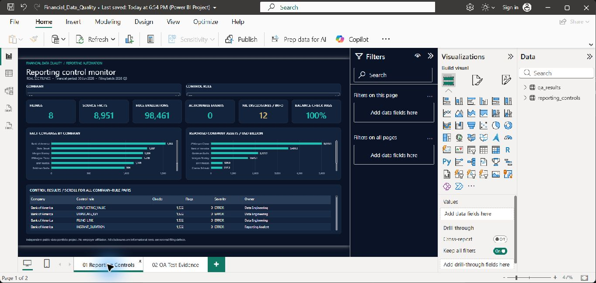
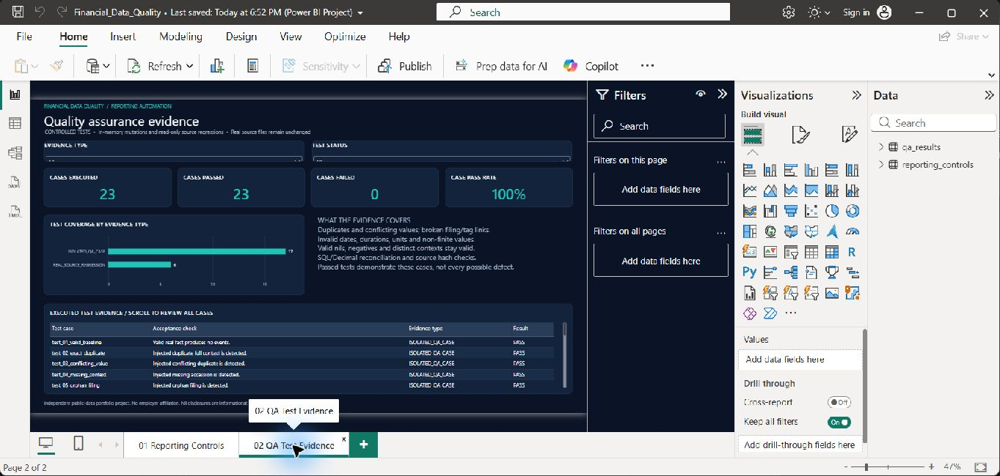

# Financial Data Quality & Reporting Automation

A SQL-first financial reporting control project using **real public SEC filings**. Python validates source records, SQLite answers operational questions, and a two-page Power BI report presents control health and test evidence.

Independent portfolio project; no affiliation with Morgan Stanley or any other filer. This monitors a public-data ingestion workflow, not a bank's internal trading or customer systems.

## Verified source scope

| Item | Actual scope |
| --- | ---: |
| SEC download batch | 2026 Q3 |
| Financial reporting period selected for headline metrics | 30 June 2026 |
| Companies / filings | 8 / 8 |
| Numeric facts | 8,951 |
| Tag definitions | 531 |
| Presentation rows | 1,223 |
| Rule evaluations | 98,461 across 11 rules |
| Actionable ERROR / REVIEW events | 0 |
| Informational nil disclosures | 12 |
| Same-context balance-sheet total checks passed | 8 / 8 |
| Automated tests passed | 23 / 23 |

Companies: Morgan Stanley, Goldman Sachs, JPMorgan Chase, Bank of America, Charles Schwab, State Street, BNY Mellon and Blackstone. The sample was chosen for financial-services relevance, not statistical representativeness.

**The filing batch is not the accounting period.** The retained filings were submitted during the 2026 Q3 download batch and report June 2026 financial statements; comparative facts retain their original dates and durations.

## Run locally

Python 3.10+; standard library only. No paid data subscription or database server is needed.

```sh
python pipeline.py
python test_controls.py
```

Custom directories are supported:

```sh
python pipeline.py --input-dir data/raw --output-dir reports
```

The pipeline rebuilds only its derived local SQLite tables and report exports. Raw TSV files are read-only inputs. `test_controls.py` uses the checked-in `data/raw` and `reports` folders for the reproducible baseline.

## Power BI report





Open `Financial_Data_Quality.pbip` in Power BI Desktop. The report has:

1. **Reporting Controls:** company/rule slicers, scoped filing/fact counts, control evaluations, actionable events, informational nils, balance-check coverage, company fact coverage and control details.
2. **QA Test Evidence:** executed test results, controlled-case versus source-regression evidence, status filters and case-level acceptance checks.

The GitHub copy excludes the local Power BI data cache. Its default CSV paths are `C:\financial-data-quality-reporting\reports\dashboard_controls.csv` and `C:\financial-data-quality-reporting\reports\test_results.csv`. If moved, update both CSV sources in **Transform data → Data source settings → Change Source**, then refresh. Run the Python pipeline and tests before refreshing to update both report inputs. Report values are snapshots of the most recent local run; no scheduled refresh is configured.

The reporting control table has one row per company/filing/rule. Filings and fact-count measures deduplicate by accession before summing; they do not multiply facts by eleven rules. Rule evaluation counts use the company/rule context. QA results have their own independent filters.

## SQL and automation

Review `queries.sql` for eight business-oriented queries: company coverage, complete-context duplicates, source metric reconciliation, candidate ambiguity, exception ownership, control-health rates, taxonomy/units analysis and presentation coverage without row multiplication.

`pipeline.py` preserves the complete fact context `(adsh, tag, version, ddate, qtrs, uom, segments, coreg)`. Taxonomy lookups use tag **and version**. Presentation mappings use existence checks rather than a join that would multiply facts.

Running the pipeline generates `reports/financial_quality.sqlite` (not checked into GitHub), which allows interviewers to inspect the loaded tables and rerun queries. Monetary calculations use Python Decimal; independently selected SQL metrics are reconciled within USD 0.01.

## Real findings versus controlled tests

No rows in `data/raw` have injected errors. The real data has twelve nil values on `CommitmentsAndContingencies` disclosures. These are preserved as unknown and reported at INFO severity—not converted to zero or described as fraudulent/incorrect filings.

The test suite separately changes in-memory copies to exercise defects such as duplicates, invalid values and broken references. Negative numbers and different reporting contexts also have tests to prevent false positives. Successful tests show the checked cases work; they do not prove universal data correctness.

## Evidence and business documentation

- `data/source_manifest.json`: source URL, selection, extraction counts and SHA-256 hashes.
- `reports/run_summary.json`: actual run counts and source hashes.
- `reports/exceptions.csv`: traceable events with accession, fact context, severity and owner.
- `reports/control_results.csv`: every company/rule evaluation total.
- `reports/company_metrics.csv`: selected facts, balance checks and filing links.
- `reports/test_results.csv`: all 23 executed acceptance checks.
- `docs/REQUIREMENTS.md`: scope, stakeholder questions and data contracts.
- `docs/USER_STORIES.md`: user journeys, acceptance criteria and delivery backlog.
- `docs/OPERATING_PROCEDURE.md`: rerun, investigation and escalation workflow.
- `docs/INSIGHTS.md`: verified observations and limitations.
- `docs/DATA_DICTIONARY.md`: raw keys, derived fields and aggregation rules.

## Provenance

Source: [SEC Financial Statement Data Sets](https://www.sec.gov/data-research/sec-markets-data/financial-statement-data-sets), [2026 Q3 ZIP](https://www.sec.gov/files/dera/data/financial-statement-data-sets/2026q3.zip), and [official data dictionary](https://www.sec.gov/files/financial-statement-data-sets.pdf).

Only the eight selected filing accessions were retained from SUB, NUM and PRE; relevant tag/version definitions were retained from TAG. Source values were not generated or adjusted. The full downloaded archive SHA-256 and extracted subset hashes are recorded in the manifest. The original download is about 62 MB compressed and is not needed to rerun the included subset.

To repeat extraction, download the official archive and run:

```sh
python extract_sec.py --archive PATH_TO_2026q3.zip
```

## Limitations

This is a bounded filing sample, not a production regulatory or investment decision system. It has no private account data, settlement matching, external ticket creation, currency conversion or automated remediation. Some checks validate structural contracts rather than the economic truth of disclosures. A clean run does not certify the original filings. The direct balance-sheet total comparison is a consistency check, not independent verification of every accounting component. Tests and run counts are sample-specific.

## Current delivery status

Python pipeline, SQL exports, source reconciliation, repeat-run results and 23 automated tests: verified. Both Power BI pages were refreshed, rendered, checked and saved in Desktop; representative company/evidence filters were exercised. Details and limitations are recorded in `docs/DELIVERY_STATUS.md`. This source package is published at https://github.com/rishabhghosh54-spec/financial-data-quality-reporting. The interactive report runs locally in Power BI Desktop; no Power BI service publication is configured.
